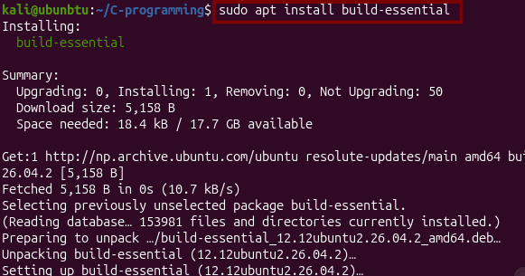
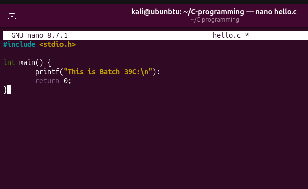
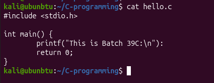
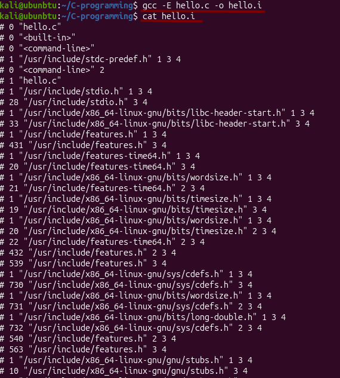
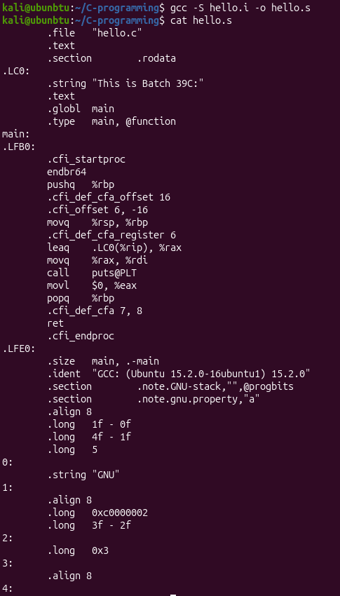
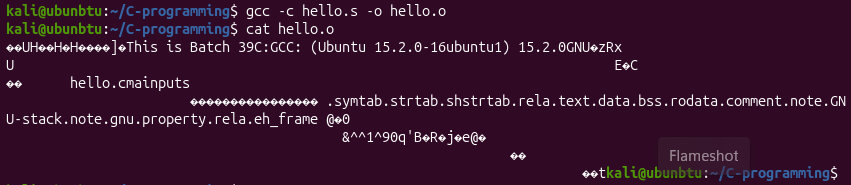
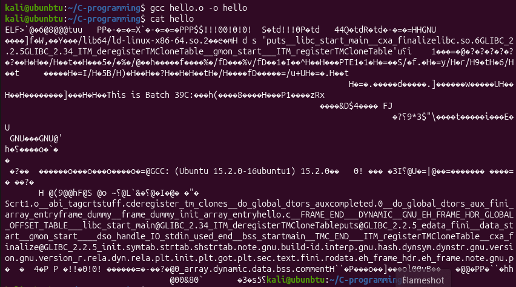

# Lab 1: Compilation

Full report: [`document/1.pdf`](../document/1.pdf)

## Overview
This lab walks through the four stages GCC performs to turn a C source file into an executable, inspecting the output of each stage. The program is a minimal "hello world" that prints `This is Batch 39C:`.

## Files

| File | Stage | Produced by |
|------|-------|-------------|
| `hello.c` | Source code | written by hand |
| `hello.i` | Preprocessed source | `gcc -E hello.c -o hello.i` |
| `hello.s` | Assembly | `gcc -S hello.i -o hello.s` |
| `hello.o` | Object file (not yet linked) | `gcc -c hello.s -o hello.o` |
| `hello` | Linked executable | `gcc hello.o -o hello` |

## Build and run

```bash
sudo apt install build-essential   # installs gcc
gcc -E hello.c -o hello.i          # 1. Preprocess
gcc -S hello.i -o hello.s          # 2. Compile to assembly
gcc -c hello.s -o hello.o          # 3. Assemble to object code
gcc hello.o    -o hello            # 4. Link
./hello
```

## What each stage does
1. **Preprocess:** expands `#include <stdio.h>`, pulling the contents of the header into the file, and removes comments.
2. **Compile:** translates the C code into x86-64 assembly. In `hello.s` the call to `printf` appears as `puts@PLT`, because GCC optimises a `printf` of a plain string ending in a newline into `puts`.
3. **Assemble:** converts the assembly into machine code in an ELF relocatable object. It is not yet runnable because `puts` is still unresolved.
4. **Link:** combines the object file with the C runtime and `libc`, resolving `puts` and producing the final executable.

## Screenshots








